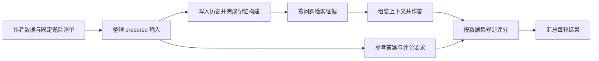

# Benchmark 功能与运行流程

Benchmark 把六套文本数据接到同一条评测流程上：读取一轮历史和问题，让不同记忆方法分别写入、检索，再用共同的模型作答，按各数据集的规则评分。运行结束后，可以从结果中查看题目得分、检索证据、模型回答和调用记录。

目前接入 AMI、Mem0、InvMem、ReFind。评测使用 seed 17–21 对应的五份固定清单，每轮约 200 题。四种方法共用同一轮输入，各自建立记忆。想先看看真实数据，可以从 [seed 17 样例](sample.md) 开始。

## 目录里有什么

在 `ami-reproduction` 仓库中，这部分代码位于 `benchmark/`。下面的路径均相对于 Benchmark 根目录。

```text
benchmark/
├── README.md                    项目入口与常用操作
├── pyproject.toml               Python 依赖、安装方式和命令行入口
├── .env.example                 模型接口配置模板
├── configs/                     数据、方法和运行参数
│   ├── datasets/                作者数据版本与下载来源
│   ├── reproduction/            五轮题目清单、抽样参数和复现配置
│   ├── suites/                  数据集组合，包括人工接入样例
│   └── local/                   配置脚本生成的本机路径和方法配置
├── src/memory_benchmark/         公共评测程序
│   ├── benchmarks/              数据读取、题型映射、作答模板和评分接口
│   │   ├── locomo_refined/      LoCoMo 的读取、提示词和评分
│   │   └── longmemeval/         LongMemEval 的读取、提示词和评分
│   ├── methods/                 AMI、Mem0 与统一方法接口
│   ├── pipeline/                输入整理、上下文组装、作答、评分和汇总
│   └── runtime/                 队列、记忆子进程、模型调用和运行记录
├── integrations/                InvMem、ReFind 的接入代码
│   ├── adapters/                将统一历史和问题送入原生方法
│   └── native_bridge/           执行记忆任务，再接入公共作答与评分阶段
├── sources/                     评分源码、能力分类和方法版本记录
│   └── aml/                     六个数据版本使用的评分源码
├── patches/                     固定原生版本所需的兼容补丁
│   └── tests/                   补丁的接口检查
├── scripts/                     配置、下载、题集准备和接入检查工具
├── samples/                     真实评测数据的阅读样例
│   └── seed-17/                 22 份完整历史及其 202 组 QA pairs
├── examples/                    供快速接入检查使用的人工数据
│   └── smoke/                   两份历史、三道问题
├── tests/                       公共程序的回归检查
├── docs/                        功能介绍、部署步骤、评分规则和数据说明
│   └── references/              抽样脚本使用的历史参考表
├── datasets/                    原始数据及下载记录
│   └── raw/                     各作者数据版本
├── baselines/                   安装时获取的四个原生方法仓库和环境
├── models/                      方法初始化使用的本地缓存，如 Mem0 BM25
└── runs/                        整理后的输入、记忆数据库和评测结果
```

CLBench、BEAM、PersonaMem v1/v2 的读取逻辑集中在 `benchmarks/public_datasets.py`。它们与 LoCoMo、LongMemEval 一起，输出相同的 History、Query、Target 结构；这些结构定义在 `schemas.py`。

理解主流程时，可以重点看下面几个入口。

| 文件 | 负责的工作 |
|---|---|
| `scripts/configure_release.py` | 生成本机的数据路径、方法路径和运行配置 |
| `scripts/prepare_five_seeds.py` | 按五轮既有题目清单整理完整历史、问题和评分目标 |
| `scripts/release_smoke.py` | 用三道人工题检查四种方法的真实接口链路 |
| `runtime/queue.py` | 调度 AMI、Mem0 的历史任务，保存各阶段进度 |
| `integrations/native_bridge/runner.py` | 调度 InvMem、ReFind，并接入公共作答和评分 |
| `runtime/worker.py` | 在原生方法的独立环境中完成记忆写入和检索 |
| `pipeline/reader.py` | 将检索证据和问题组装为提示词，生成回答 |
| `pipeline/evaluate.py` | 选择对应数据集的评分流程 |
| `pipeline/aggregate.py` | 汇总题目、数据集和能力分组得分 |

表中 `runtime/`、`pipeline/` 的文件均位于 `src/memory_benchmark/` 下。

## 一轮评测怎样完成



### 1. 配置数据和方法

开始运行前，先准备公共 Python 环境和四个方法各自的环境，再填写模型接口凭据。配置脚本把这些位置写入 `configs/local/`，运行时便能找到对应的解释器、源码和数据文件。

聊天模型使用 GPT-4o mini。AMI、Mem0、InvMem 通过共享 embedding 接口获得向量；ReFind 使用原生 BM25 和检索 agent。方法参数保存在各自配置中，公共层负责组织输入、接收证据和执行后续步骤。

安装、路径设置和可直接执行的命令见 [model_handoff_99.md](model_handoff_99.md)。下文命令均为说明流程的伪代码。

```text
local_config = configure_release(
    原生仓库与解释器路径,
    数据路径,
    模型接口凭据位置
)
```

### 2. 整理一轮输入

`configs/reproduction/seed-17.json` 等文件记录了系列测试使用的题目 ID。准备程序按这些清单读取对应的完整历史和 QA，分别写成三类文件：

| 文件 | 内容 | 后续用途 |
|---|---|---|
| `history.json` | 对话角色、消息正文、时间和顺序 | 写入记忆 |
| `queries.jsonl` | 题干、选项及题目时间 | 检索和作答 |
| `targets.eval.jsonl` | 参考答案、评分要求和能力标签 | 评分和统计 |

一份历史可以对应多道问题。LoCoMo 和 BEAM 按 conversation 组织；LongMemEval 每道题使用自己的完整 haystack；PersonaMem v1 使用该题对应的历史前缀，v2 使用完整 persona 历史；CLBench 按 task 组织上下文和最终任务。

```text
prepared = prepare_five_seeds(
    原始数据,
    seed_17_到_21_的既有清单,
    local_config.runtime
)
```

准备完成后，每个 seed 都有自己的目录。后续四种方法读取同一个 seed 的输入，从而保持历史与 QA pairs 的对应关系。

### 3. 写入历史，构建记忆

队列以“方法 × 历史”为单位执行。每份历史会交给一个方法进程，进程按原有顺序逐个写入 session，再完成该方法的记忆构建。

AMI、Mem0、InvMem、ReFind 在这一步分别使用自己的提取、存储和更新方式。公共程序记录写入结果与耗时，并为该任务保存独立的记忆数据库。

```text
memory = method.open(当前历史)
for session in 当前历史:
    memory.add(session)
memory.finalize()
```

### 4. 检索，再生成回答

记忆构建完成后，程序依次取出这份历史关联的问题。方法收到题目并返回证据，Reader 保留返回顺序，按运行配置组装上下文，再把上下文、题干和选项送给作答模型。

检索结果保存在 `retrievals.jsonl`，回答及使用的上下文保存在 `answers.jsonl`。查看同一道题的这两个文件，就能看到方法找到了什么、模型依据哪些内容作答。

```text
for query in 当前历史的题目:
    evidence = memory.search(query)
    context = reader.pack(evidence, 运行配置)
    answer = reader.answer(query, context)
    save(evidence, answer)
```

### 5. 按数据集规则评分

一份历史的回答保存后，评分程序读取相应的 Target。不同数据集关注的结果不同：LoCoMo、LongMemEval 判断答案是否正确；PersonaMem v1 匹配选择题答案；PersonaMem v2 评估回答对用户偏好的遵循；CLBench 检查整组 rubric；BEAM 对题内各条 rubric 评分后取平均。

题目评分保存在 `native_scores.jsonl`。对应的模型响应、评分过程和调用记录随任务一起保存，便于沿着题目 ID 查看结果。

```text
for query, answer in 已保存的回答:
    target = 读取该题评分目标(query.qa_id)
    score = dataset.evaluate(query, answer, target)
    save(score)
```

### 6. 汇总一轮和五轮结果

程序先对每个数据集的题目得分取平均，再对六个数据集分数取等权平均，得到该轮 Overall。能力大类和小类另有分组统计。

五个 seed 各自运行完后，可由五轮得分计算均值、样本方差和样本标准差。每一轮都重新建立该轮的方法记忆。

## 常用流程的快捷写法

下面把整套操作放在一起。名称对应仓库中的脚本或模块，参数用流程概念表示；实际执行时按 [交接文档](model_handoff_99.md) 填写命令。

```text
configure_release(本机路径和接口配置) -> configs/local/
prepare_five_seeds(原始数据, 固定题目清单) -> 五轮 prepared 输入
release_smoke(四种方法, 人工样例) -> 接入检查结果

for seed in [17, 18, 19, 20, 21]:
    queue(prepared[seed], AMI) -> AMI 本轮结果
    queue(prepared[seed], Mem0) -> Mem0 本轮结果
    native_bridge(prepared[seed], InvMem) -> InvMem 本轮结果
    native_bridge(prepared[seed], ReFind) -> ReFind 本轮结果

汇总(各方法的五轮结果) -> 均值、样本方差、样本标准差
```

## 结果从哪里看

单个方法、单个 seed 的运行目录大致如下：

```text
runs/<本轮运行>/
├── manifest.json                本轮输入、方法和运行参数
├── progress.json                当前阶段与任务进度
├── <method>.scores.jsonl         逐题评分
├── <method>.summary.json         数据集、能力分组及 Overall
├── <method>.reliability.json     置信区间与来源分组统计
└── <method>/<benchmark>/<case>/
    ├── retrievals.jsonl          每道题检索到的证据
    ├── answers.jsonl             模型回答和作答上下文
    ├── native_scores.jsonl       数据集评分结果
    ├── checkpoint.json           已完成阶段
    └── memory_attempt_001/       记忆写入、检索和调用记录
```

先看 `progress.json` 了解运行进度，再看 `summary.json` 的整体结果。需要理解某道题时，沿着 QA ID 查看检索、回答和评分文件。队列再次启动时，会从已保存的阶段继续。

数据实例见 [sample.md](sample.md)，评分字段和计算规则见 [evaluation_contract.md](evaluation_contract.md)。
